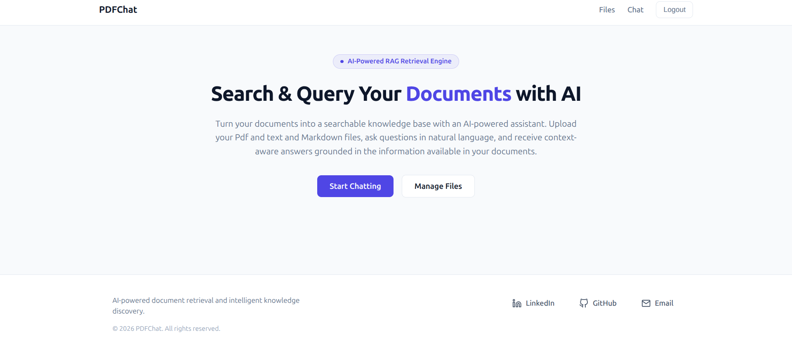
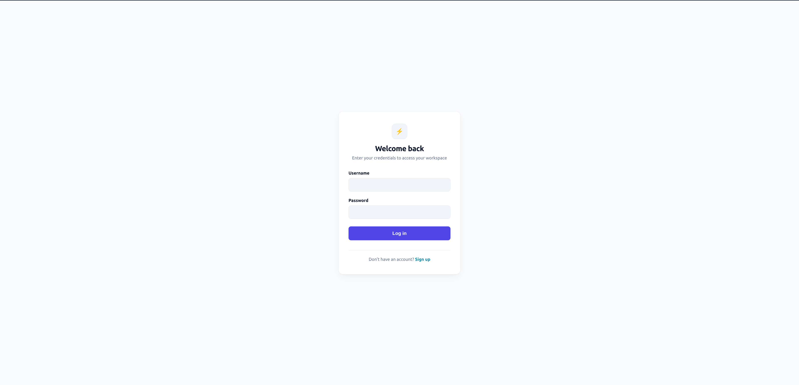
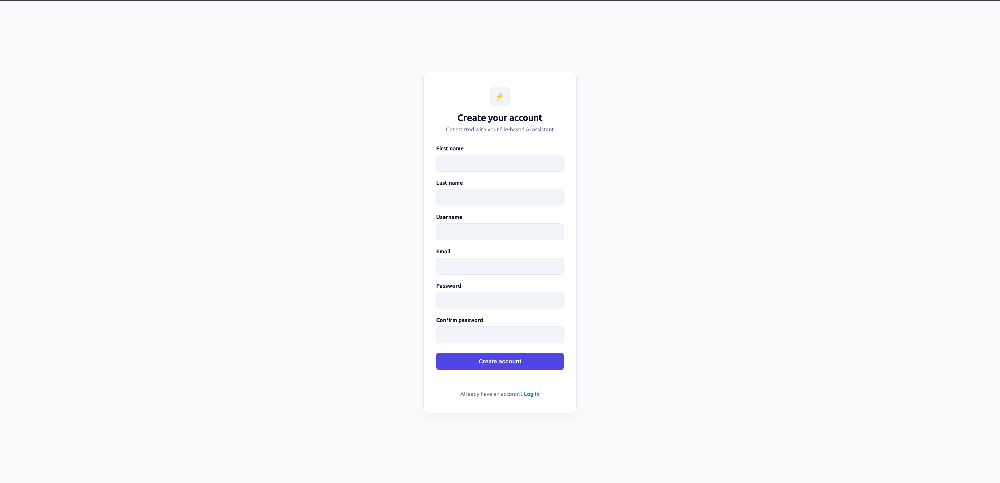
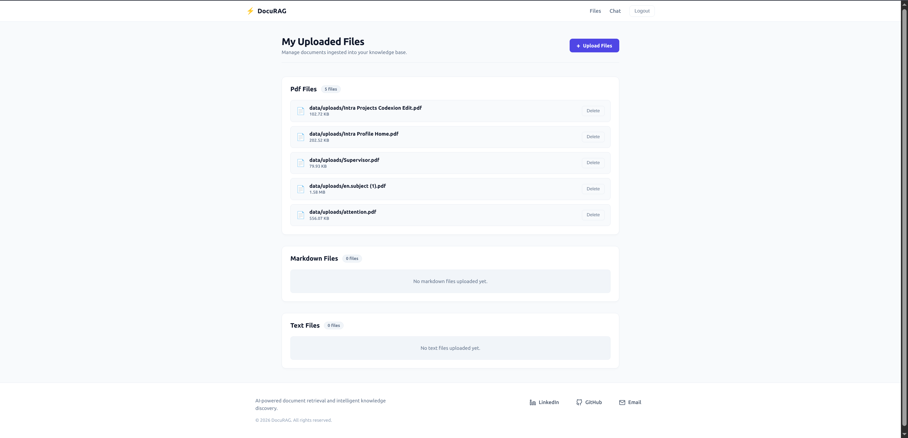
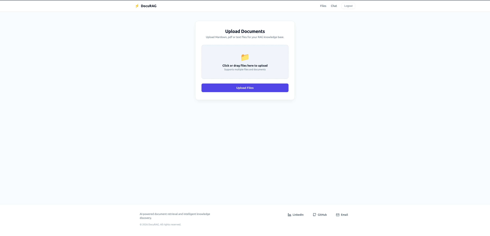
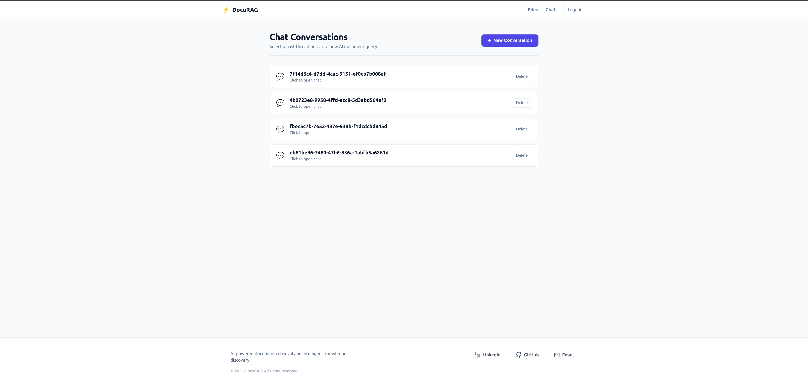
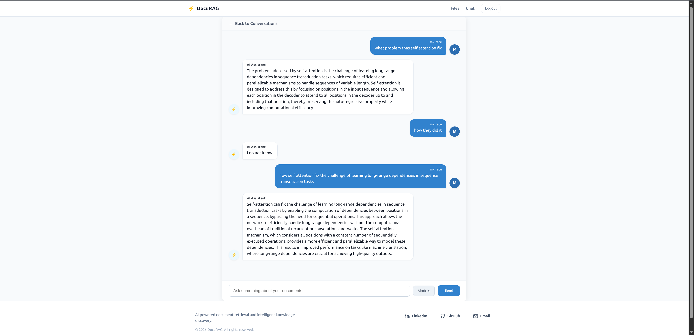

# PDFChat — Chat with Your Documents Using RAG

PDFChat is a document-based question-answering application that allows users to upload their own documents and interact with them through a conversational interface.

The project implements a **Retrieval-Augmented Generation (RAG)** pipeline using LangChain and Hugging Face Transformers. Instead of relying only on the language model's internal knowledge, the system retrieves relevant information from the user's uploaded documents and uses it as context to generate answers.

PDFChat supports PDF, Markdown, and plain-text files, making it useful for asking questions about CVs, technical documentation, reports, notes, and other personal documents.

## Features

- **User authentication:** Each user has an account and can manage their own uploaded documents.
- **Multiple document formats:** Supports `.pdf`, `.md`, and `.txt` files.
- **Document processing:** Splits documents into smaller chunks for efficient retrieval.
- **Hybrid retrieval:** Combines lexical search using BM25 with semantic search using sentence embeddings.
- **Context-aware answers:** Generates responses using information retrieved from uploaded documents.
- **Open-source language models:** Uses Hugging Face Transformers for text generation.
- **Configurable generation model:** Uses `Qwen/Qwen3-0.6B` by default, with support for other compatible models.
- **Web interface:** Provides an interface built with HTML and CSS.
- **Django backend:** Handles authentication, document management, and application logic.


## Application Screenshots

### Home Page

The main interface of PDFChat.



### Login Page

Secure authentication for existing users.



### Register Page

Create an account to start using PDFChat.



### Uploaded Files

View the documents associated with your account.



### Upload Documents

Upload PDF, Markdown, and plain-text files to use as context for your conversations.



### Conversations

Access and manage your conversations.



### Chat with Your Documents

Ask questions about your uploaded documents and receive answers generated using the RAG pipeline.




## RAG Pipeline

PDFChat uses a simple RAG architecture consisting of document processing, retrieval, prompt construction, and answer generation.

### Architecture

```text
                 User
                  |
                  v
          Upload Documents
          (.pdf, .md, .txt)
                  |
                  v
          Document Loading
                  |
                  v
          Recursive Chunking
                  |
                  v
           Document Chunks
                  |
                  v
          Hybrid Retrieval
             /         \
            v           v
       BM25 Search   Semantic Search
                      all-MiniLM-L6-v2
            \           /
             \         /
                  v
          Relevant Documents
                  |
                  v
          Prompt Construction
          (System Prompt + Context
                + User Query)
                  |
                  v
           Qwen3-0.6B Model
                  |
                  v
            Generated Answer
```

### 1. Document Loading and Chunking

The application loads the documents uploaded by the user and splits their content into smaller, overlapping chunks using LangChain's `RecursiveCharacterTextSplitter`.

Chunking helps the retrieval system identify relevant passages without processing entire documents as a single unit.

Supported file formats:

- `.pdf` — PDF documents
- `.md` — Markdown documents
- `.txt` — Plain-text documents

### 2. Hybrid Retrieval

PDFChat combines two retrieval approaches to improve the relevance of retrieved information.

**Lexical retrieval — BM25**

BM25 ranks documents according to keyword overlap and term importance. It is useful when a query contains specific terms, names, or technical expressions.

**Semantic retrieval — Sentence Transformers**

The application uses `sentence-transformers/all-MiniLM-L6-v2` to convert text into vector embeddings. Semantic search uses these representations to identify passages with similar meanings, even when they do not share exactly the same words.

Combining lexical and semantic retrieval helps the system benefit from both keyword matching and semantic similarity.

### 3. Prompt Construction and Augmentation

The retrieved passages are added to a prompt alongside the user's question and system instructions.

The system prompt guides the language model to use the retrieved context as evidence when answering questions.

The project uses Hugging Face Transformers' chat-template functionality to format messages for the generation model.

### 4. Answer Generation

The default generation model is `Qwen/Qwen3-0.6B`, loaded using Hugging Face Transformers.

The model receives the constructed prompt and generates a response based on the available context.

The generation model can be changed to another compatible model, depending on the user's hardware and requirements.

## Technologies

| Technology | Purpose |
|---|---|
| Python | Core programming language |
| Django | Backend, authentication, and request handling |
| LangChain | Document processing and retrieval components |
| Hugging Face Transformers | Prompt formatting and text generation |
| Sentence Transformers | Semantic embeddings |
| BM25 | Lexical information retrieval |
| Qwen3-0.6B | Default text-generation model |
| HTML | Frontend structure |
| CSS | Frontend styling |

## Getting Started

## Prerequisites

Before running PDFChat, make sure you have the following installed:

- **Python 3** — a version compatible with the project's dependencies.
- **uv** — Python package and project manager.
- **Git** — to clone the repository.
- **Make** — to execute the commands defined in the `Makefile`.

Since PDFChat uses Hugging Face models for embeddings and text generation, you will also need an internet connection for the initial model downloads and sufficient memory to run the selected models.

## Getting Started

### 1. Clone the Repository

```bash
git clone <YOUR_REPOSITORY_URL>
cd PDFChat
```

### 2. Install Dependencies

Install the project dependencies using the provided Makefile:

```bash
make install
```

This command installs `uv` using `pip` and then runs `uv sync` to install the project's dependencies.

### 3. Apply Database Migrations

Initialize or update the database schema:

```bash
make migrate
```

If you have modified Django models and need to create new migrations, run:

```bash
make makemigrations
make migrate
```

### 4. Create a Superuser (Optional)

To create an administrative account for the Django admin interface:

```bash
make superuser
```

Follow the prompts to enter the account details.

### 5. Run the Development Server

Start the Django development server:

```bash
make run
```

Open your browser and navigate to:

```text
http://127.0.0.1:8000/
```

### Available Make Commands

The project includes a Makefile to simplify common development tasks.

| Command | Description |
|---|---|
| `make install` | Install `uv` and synchronize project dependencies. |
| `make run` | Start the Django development server. |
| `make add_app APP=app_name` | Create a new Django application. |
| `make makemigrations` | Generate database migrations from model changes. |
| `make migrate` | Apply database migrations. |
| `make superuser` | Create a Django superuser. |
| `make clean` | Remove `__pycache__` directories. |
| `make help` | Display available Make commands. |

**Example:** To create a new Django app named `documents`, run:

```bash
make add_app APP=documents
```


## How to Use PDFChat

1. **Create an account:** Register a new user account or sign in.
2. **Upload documents:** Upload one or more supported PDF, Markdown, or plain-text files.
3. **Open the chatbot:** Navigate to the conversation interface.
4. **Ask questions:** Submit questions about the content of your uploaded documents.
5. **Receive answers:** The application retrieves relevant passages and uses them to generate an answer.
6. **Manage your documents:** Access the documents associated with your account through the application's interface.

For better results, ask specific questions related to the information contained in your documents.

## Project Structure

The following is an example structure. Adjust the directory names to match your actual repository.

```text
PDFChat/
├── manage.py
├── requirements.txt
├── loading/
│   ├── models.py
│   ├── views.py
│   └── ...
├── chatbot/
│   ├── models.py
│   ├── views.py
│   └── ...
├── rag_system/
│   ├── ...
├── templates/
│   ├── home.html
│   ├── upload_file.html
│   └── ...
├── static/
│   └── ...
└── README.md
```

## Model Configuration

PDFChat uses `Qwen/Qwen3-0.6B` as its default generation model.

You can configure another compatible Hugging Face model if it supports the application's prompt format and generation workflow.

When choosing a model, consider:

- Model size and memory requirements.
- Response quality and generation speed.
- Compatibility with Hugging Face Transformers.
- Your CPU/GPU hardware.
- The model's tokenizer and chat-template requirements.

The embedding model, `sentence-transformers/all-MiniLM-L6-v2`, is used for semantic retrieval and is separate from the generation model.

## Project Objective

The goal of PDFChat is to build a practical document-question-answering application while exploring the core components of Retrieval-Augmented Generation: document processing, chunking, hybrid retrieval, prompt construction, and local language-model inference.

The project also demonstrates how an NLP pipeline can be integrated into a web application using Django, authentication, and a simple frontend.
